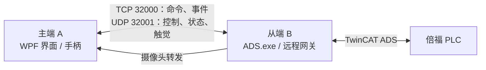

# 主从分机项目架构说明

## 项目组成

本软件包按部署角色拆分为主端 A 与从端 B。主端运行在人机操作电脑上，负责界面、主端手柄和远程命令；从端运行在机器人附近，连接 PLC 并执行现有控制逻辑。

## 目录与模块

- `A_主端电脑_地址修正版/工程`：主端源码。核心解决方案为 `master/MasterConsole.sln`，包含 WPF 主界面（`MasterConsole`）和协议库（`MasterConsole.Protocol`）；手柄由主端本机 SDK 读取，界面还包含相机和模型显示相关资源。
- `B_从端电脑/工程`：从端源码。核心为 `ADS项目/ADS.sln`：C++ ADS 主程序及控制模块包括 PLC 通信、远程网关、力反馈、运动同步、启动流程、实验记录和摄像头转发；`AdsControlUI` 是从端本地调试台，通过命名管道与 ADS 程序交互。
- 两端各自的 `protocol` 目录保存协议说明、实现和测试向量；改动协议时应同步核对 C#、C++ 实现及向量。
- 根目录的部署教程、两端使用说明和 `验证记录` 用于部署与问题追踪；两端 ZIP 是分发包。

## 通信与数据流

从端监听 TCP 32000，使用长度前缀 JSON 承载握手认证、控制命令、回执和事件。UDP 32001 承载主端约 100 Hz 的手柄/按住式控制帧；从端回传约 15 Hz 状态帧及约 100 Hz 触觉帧。PLC 通信走从端的 TwinCAT ADS 链路，摄像头转发也由从端提供。

远程协议使用两端一致的 `config/remote.token`；TCP 认证使用 HMAC，UDP 帧带会话 MAC。TCP JSON 内容本身未加密，端口应限制在可信的隔离网络内，不应映射到公网。

## 工程与配置要点

- 主端为 x64 WPF，目标 .NET Framework 4.7.2；从端 ADS 为 x64 C++17，使用 Visual Studio C++ v142 工具集和 Windows SDK。从端控制 PLC 还依赖正确的 TwinCAT ADS Router/路由配置。
- 日常入口是两端目录中的“编译并启动”脚本或 CMD 启动器；脚本会先构建并检查运行依赖，构建失败时不会启动旧输出。仅编译可在各自工程目录运行：`powershell -NoProfile -ExecutionPolicy Bypass -File .\build-and-run.ps1 -BuildOnly`。
- 密钥位于两端各自的 `工程/config/remote.token`，内容需一致且至少 16 字节；不要将现场密钥提交到版本库。摄像头等设备参数按各自 `工程/config` 中的模板和使用说明配置。
- 主端的 VTK/URDF 离线模型验证与 PLC 七轴状态显示是不同链路；现有部署说明指出二者尚未形成生产闭环，模型测试通过不能替代真实 PLC/机器人验证。

详细接线、网络设置和启动顺序见根目录的《主从分机部署教程.md》；源码构建细节见两端的《使用说明.md》。
